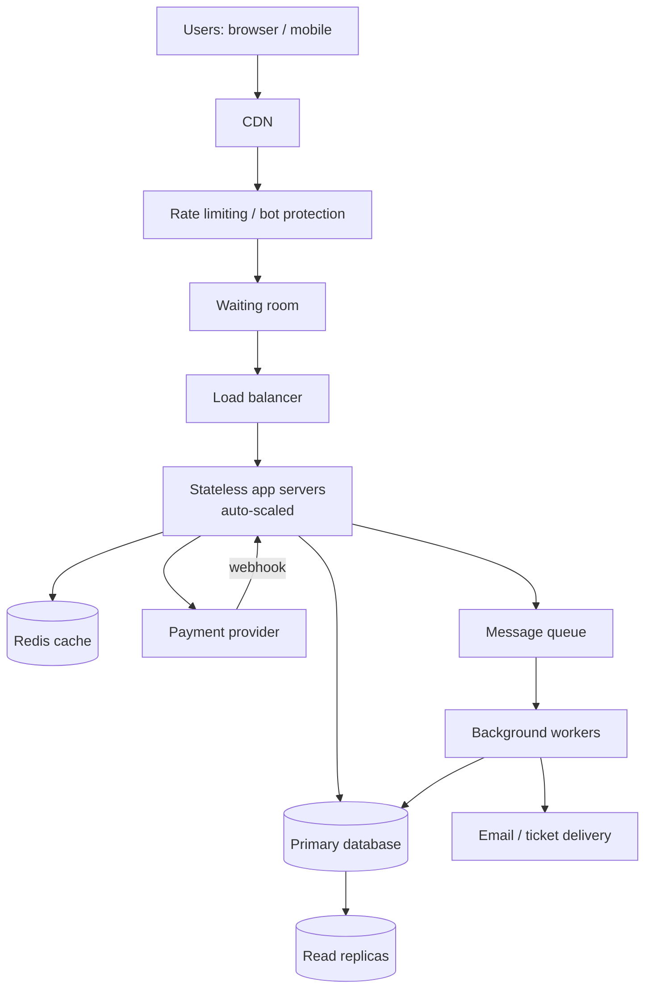

# TicketHub: Design Document

TicketHub is a website that sells tickets for concerts and events. This document follows the six-part framework: requirements, estimates, API, data model, architecture, and trade-offs.

---

## 1. Requirements

### Functional requirements

- Users can register, log in, and log out.
- Users can browse and search upcoming events (by name, city, date).
- Users can view an event's details and its seat map with live availability.
- Users can select seats and **hold** them for a short time (5 minutes) while they pay.
- Users can pay for held seats and receive their tickets.
- Users can view their purchased tickets (with a QR code) and their order history.
- Held seats that are not paid for are released automatically.

**Out of scope:** resale/transfers, refunds workflow, organizer dashboards.

### Non-functional requirements

| Category         | Requirement                                                                                                                                                        |
| ---------------- | ------------------------------------------------------------------------------------------------------------------------------------------------------------------ |
| **Speed**        | Event list and event pages load in under 300 ms (p95). Seat map loads in under 500 ms. A hold request answers in under 500 ms.                                     |
| **Correctness**  | A seat is **never** sold to two people. Zero double sales, even under heavy load. A user is never charged twice for the same order.                                |
| **Fairness**     | During a big sale, users are served roughly first-come, first-served through a waiting room. Each user is limited to 4 seats per event, and bots are rate limited. |
| **Availability** | 99.9% uptime overall. Browsing should keep working even if checkout is overloaded.                                                                                 |
| **Scalability**  | Handle a ~500x jump in traffic during a popular on-sale without redesign.                                                                                          |
| **Durability**   | Paid orders and tickets are never lost.                                                                                                                            |
| **Security**     | Passwords hashed, HTTPS everywhere, card data handled only by the payment provider (we never store card numbers).                                                  |

---

## 2. Estimates

### Given facts

- 2,000,000 registered users
- Normal day: 50,000 visitors, 10 pages each, 5,000 tickets sold
- Big sale: 200,000 people try to buy 20,000 seats in the first 10 minutes

### Normal day

- Page views: 50,000 × 10 = **500,000 per day**
- Average rate: 500,000 / 86,400 s ≈ **6 requests/second**
- Allowing a 10x busy hour: roughly **60 requests/second**
- Tickets sold: 5,000 / 86,400 s ≈ **0.06 purchases/second** (about 1 every 17 seconds)
- Storage: 5,000 orders/day × ~500 bytes (order, tickets, payment) ≈ 2.5 MB/day ≈ **~1 GB/year**. This is tiny.

### Big sale (first 10 minutes = 600 seconds)

Assumption: each buyer makes about 10 requests (open event page, load seat map a few times, try seats, pay).

- Users arriving: 200,000 / 600 s ≈ **333 new users/second**
- Requests: 200,000 × 10 = 2,000,000 / 600 s ≈ **3,300 requests/second** on average. The first minute will be higher, perhaps 2 to 3x that, so we plan for **~10,000 requests/second at the spike**.
- Seats sold: 20,000 / 600 s ≈ **33 successful purchases/second**
- Seat-hold attempts: assume ~3 attempts per user = 600,000 / 600 s ≈ **1,000 hold attempts/second**, all aimed at the **same 20,000 rows**
- Only 20,000 of 200,000 people can win, so **90% will fail**. The design must make failing fast and fair, not just make winning correct.

### Comparison

| Metric                  | Normal day                | Big sale                          | Factor                    |
| ----------------------- | ------------------------- | --------------------------------- | ------------------------- |
| Average requests/second | ~6                        | ~3,300 (spike ~10,000)            | **~500x** (up to ~1,500x) |
| Purchases/second        | ~0.06                     | ~33                               | **~550x**                 |
| Concentration           | Spread across many events | All on one event, 20,000 hot rows | Hot-spot contention       |
| Duration                | All day                   | 10 minutes                        | Very spiky                |

**Conclusion:** The data is small, but the load is extremely spiky and concentrated on one event. We cannot simply size the system for a normal day. We need to absorb the spike (CDN, cache, waiting room) and protect the database, which is the part that must stay correct.

---

## 3. API

REST over HTTPS, JSON. All endpoints except browsing require an auth token.

| #   | Method & path                           | Purpose                                                              | Notes                                                                      |
| --- | --------------------------------------- | -------------------------------------------------------------------- | -------------------------------------------------------------------------- |
| 1   | `GET /events?query=&city=&date=&page=`  | Browse and search events                                             | Cacheable, paginated                                                       |
| 2   | `GET /events/{event_id}`                | Event details                                                        | Cacheable at the CDN                                                       |
| 3   | `GET /events/{event_id}/seats?section=` | View seats and availability                                          | Served from cache (1 to 2 s old)                                           |
| 4   | `POST /events/{event_id}/holds`         | Hold seats. Body: `{ "seat_ids": [101, 102] }`                       | Returns `hold_id` and `expires_at`, or `409 Conflict` if any seat is taken |
| 5   | `DELETE /holds/{hold_id}`               | Release a hold early                                                 |                                                                            |
| 6   | `POST /orders`                          | Pay for a hold. Body: `{ "hold_id": "...", "payment_token": "..." }` | Requires an `Idempotency-Key` header                                       |
| 7   | `GET /me/tickets`                       | View my tickets                                                      |                                                                            |
| 8   | `GET /me/orders/{order_id}`             | View one order and its status                                        |                                                                            |
| 9   | `POST /auth/login`                      | Log in                                                               | Rate limited                                                               |
| 10  | `POST /payments/webhook`                | Payment provider confirms the result                                 | Signature verified                                                         |

### Example hold response

```json
// 201 Created
{ "hold_id": "h_8f3a", "seat_ids": [101, 102], "expires_at": "2026-11-05T19:05:00Z" }

// 409 Conflict
{ "error": "SEAT_UNAVAILABLE", "unavailable_seat_ids": [102] }
```

The flow is: **browse → view seats → hold → pay → view tickets**.

---

## 4. Data model

```text
users 1 ──< orders >── 1 events >── 1 venues
                │            │
                │            └──< event_seats
                │                       │
                └──< tickets >──────────┘ (each ticket points to exactly one event_seat)
                └──< payments
```

### Tables

#### users

| Column        | Type             | Notes |
| ------------- | ---------------- | ----- |
| id            | bigint, PK       |       |
| email         | text, **UNIQUE** |       |
| name          | text             |       |
| password_hash | text             |       |
| created_at    | timestamp        |       |

#### venues

| Column     | Type       | Notes |
| ---------- | ---------- | ----- |
| id         | bigint, PK |       |
| name, city | text       |       |

#### events

| Column     | Type                | Notes                              |
| ---------- | ------------------- | ---------------------------------- |
| id         | bigint, PK          |                                    |
| venue_id   | bigint, FK → venues |                                    |
| title      | text                |                                    |
| starts_at  | timestamp           |                                    |
| on_sale_at | timestamp           | when the waiting room opens        |
| status     | enum                | draft, on_sale, sold_out, finished |

#### event_seats (one row per seat per event)

| Column               | Type                         | Notes                                                                    |
| -------------------- | ---------------------------- | ------------------------------------------------------------------------ |
| id                   | bigint, PK                   |                                                                          |
| event_id             | bigint, FK → events          |                                                                          |
| section, row, number | text / int                   |                                                                          |
| price_cents          | int                          |                                                                          |
| status               | enum                         | `available`, `held`, `sold`                                              |
| held_by              | bigint, FK → users, nullable |                                                                          |
| hold_expires_at      | timestamp, nullable          |                                                                          |
|                      |                              | **UNIQUE (event_id, section, row, number)**. Index on (event_id, status) |

#### orders

| Column          | Type                | Notes                               |
| --------------- | ------------------- | ----------------------------------- |
| id              | bigint, PK          |                                     |
| user_id         | bigint, FK → users  |                                     |
| event_id        | bigint, FK → events |                                     |
| status          | enum                | pending, paid, expired, failed      |
| total_cents     | int                 |                                     |
| idempotency_key | text, **UNIQUE**    | prevents double charging on retries |
| created_at      | timestamp           |                                     |

#### tickets

| Column        | Type                                 | Notes                     |
| ------------- | ------------------------------------ | ------------------------- |
| id            | bigint, PK                           |                           |
| order_id      | bigint, FK → orders                  |                           |
| event_seat_id | bigint, FK → event_seats, **UNIQUE** | one ticket per seat, ever |
| qr_code       | text                                 |                           |

#### payments

| Column       | Type                | Notes                                  |
| ------------ | ------------------- | -------------------------------------- |
| id           | bigint, PK          |                                        |
| order_id     | bigint, FK → orders |                                        |
| provider_ref | text, **UNIQUE**    | the provider's transaction id          |
| status       | enum                | authorized, captured, failed, refunded |
| amount_cents | int                 |                                        |

### Relationships

- A **venue** has many **events**; an **event** has many **event_seats**.
- A **user** has many **orders**; an **order** has many **tickets** and **payments**.
- A **ticket** links an **order** to exactly one **event_seat**.

---

## 5. How the design prevents two people from buying the same seat

**The database is the only authority on who owns a seat.** Everything else (CDN, cache, waiting room) is for speed and can be wrong without causing a double sale.

### Step 1: Hold (atomic conditional update in a transaction)

When a user requests seats, the app runs one transaction:

```sql
BEGIN;

UPDATE event_seats
SET status = 'held',
    held_by = :user_id,
    hold_expires_at = now() + interval '5 minutes'
WHERE id IN (:seat_ids)              -- always sorted by id, to avoid deadlocks
  AND event_id = :event_id
  AND ( status = 'available'
        OR (status = 'held' AND hold_expires_at < now()) );  -- expired holds are reusable

-- Check the number of rows affected.
-- If it is not equal to the number of requested seats: ROLLBACK and return 409.
COMMIT;
```

Why this is safe:

- The `WHERE status = 'available'` check and the update happen **as one atomic step**. There is no gap between "check" and "write" where another user can sneak in.
- The database takes a **row lock** on each seat. If two users go for the same seat at the same moment, one update runs first; the second then sees `status = 'held'`, matches **zero rows**, and gets a 409.
- It is **all or nothing**: if any one of the requested seats is gone, the transaction rolls back and the user holds none, so nobody ends up with half a group.

### Step 2: Purchase (confirm the hold, then record the ticket)

After the payment provider confirms payment, another transaction runs:

```sql
BEGIN;

UPDATE event_seats
SET status = 'sold'
WHERE id IN (:seat_ids)
  AND status = 'held'
  AND held_by = :user_id
  AND hold_expires_at > now();       -- the hold must still be valid

-- rows affected must equal the number of seats, otherwise ROLLBACK and refund

INSERT INTO tickets (order_id, event_seat_id, qr_code) VALUES ...;
UPDATE orders SET status = 'paid' WHERE id = :order_id;

COMMIT;
```

### Step 3: Unique constraint as the safety net

`tickets.event_seat_id` is **UNIQUE**. Even if a bug in our application code tried to sell the same seat twice, the database would reject the second insert and the transaction would fail. A double sale is therefore impossible at the data level, not just "unlikely".

### Other protections

- **Idempotency key** (`orders.idempotency_key` is UNIQUE): if the user double-clicks "Pay" or the network retries, the same order is returned and the card is charged once.
- **Hold expiry:** a background worker releases expired holds every few seconds. Because the hold query also accepts expired holds, correctness does not depend on that worker running on time.
- **Late payment:** if payment succeeds but the hold expired and someone else took the seat, the purchase transaction affects zero rows, so we refund automatically rather than sell the seat twice.
- **Stale caches are harmless:** a user may click a seat the cache still shows as free, but the hold query will reject them with a 409. The cache only affects what they _see_, never who _owns_ a seat.

---

## 6. Architecture



### Components

| Component                          | What it does                                                                                                                    | Why it is there                                                                                                                       |
| ---------------------------------- | ------------------------------------------------------------------------------------------------------------------------------- | ------------------------------------------------------------------------------------------------------------------------------------- |
| **CDN**                            | Serves static files (images, JS, CSS) and cached public event pages close to users.                                             | Takes the largest share of read traffic off our servers entirely.                                                                     |
| **Rate limiting / bot protection** | Limits requests per user/IP; blocks obvious bots.                                                                               | Fairness: one scripted buyer should not take 1,000 seats.                                                                             |
| **Waiting room**                   | During a big sale, puts users in a queue and admits them to the purchase flow at a steady rate (for example, ~2,000 at a time). | Turns a 10,000 requests/second spike into a controlled flow the database can handle. Also provides fairness (first in, first served). |
| **Load balancer**                  | Spreads requests across app servers and removes unhealthy ones.                                                                 | Horizontal scaling and availability.                                                                                                  |
| **App servers (stateless)**        | Run the API: events, seat maps, holds, orders.                                                                                  | Stateless, so we can add servers quickly. Pre-scaled before a known on-sale time.                                                     |
| **Redis cache**                    | Stores event details and seat-map snapshots (refreshed every 1 to 2 seconds), plus session and rate-limit counters.             | The seat map is read thousands of times per second; serving it from memory keeps those reads away from the database.                  |
| **Primary database (SQL)**         | Source of truth for users, events, seats, orders, tickets. Runs all hold and purchase transactions.                             | Needs ACID transactions and constraints to guarantee no double-booking.                                                               |
| **Read replicas**                  | Serve browse and search queries and rebuild the seat-map cache.                                                                 | Keeps read load off the primary, which is reserved for writes.                                                                        |
| **Payment provider**               | External service that charges the card and calls our webhook.                                                                   | We never touch card numbers (security and compliance).                                                                                |
| **Message queue + workers**        | Handle slow jobs: release expired holds, send confirmation emails, generate QR codes.                                           | Keeps the request path fast and lets us retry failed jobs.                                                                            |

### How it survives the big sale

1. **Before the sale:** the app servers and cache are scaled up ahead of `on_sale_at`, since the sale time is known in advance.
2. **Static content** goes through the CDN, so most of the traffic never reaches us.
3. **The waiting room** limits how many people are in the purchase flow at once. The other ~190,000 see a "you are in line" page that costs almost nothing to serve.
4. **The seat map** is served from the Redis cache, refreshed every 1 to 2 seconds, so thousands of viewers do not each hit the database.
5. **Only hold and purchase requests reach the primary database.** After the waiting room, that is on the order of ~1,000 hold attempts/second and ~33 successful purchases/second, which a single well-indexed primary can handle. Failed attempts are rejected quickly (zero rows updated, 409).
6. **Fast failure:** once the event is sold out, a flag in the cache returns "sold out" immediately and stops further database work.
7. **Browsing other events keeps working**, because the big sale is isolated behind the waiting room and does not starve the rest of the site.

---

## 7. Trade-offs

### Trade-off 1: Strong consistency in the database vs. speed of a cache-only approach

We decided that **seat ownership is decided in the SQL database**, not in the cache.

- **Benefit:** zero double sales; the correctness rules (transactions, unique constraints) are simple and proven.
- **Cost:** the primary database becomes the bottleneck for holds, and the seat map shown to users can be 1 to 2 seconds stale, so some users click a seat that has just been taken and see an error.
- **Why we accept it:** a wrong seat map is a minor annoyance, but a double sale is a serious failure. We protect the database with the waiting room instead of giving up consistency.

### Trade-off 2: Waiting room (fairness and stability) vs. user experience

- **Benefit:** the database and servers are protected, and the order of arrival is respected.
- **Cost:** users wait in line, even though the system might have been able to handle some of them. It also adds one more component to build and operate.
- **Why we accept it:** without it, the site would likely crash at the exact moment 200,000 people are trying to buy, which is worse for everyone.

### Trade-off 3: Hold duration (5 minutes)

- A **longer** hold gives people time to pay, so fewer payments fail, but seats stay locked and other fans cannot buy them.
- A **shorter** hold frees seats faster, but people on slow connections lose their seats mid-payment.
- We chose 5 minutes as a middle point and will tune it using real data.

### Trade-off 4: Single primary database vs. sharding

- We keep **one primary** (plus replicas) because the data is small (~1 GB/year) and a single primary keeps transactions simple.
- **Cost:** it is a single point of write failure and limits growth. If we ever need more, we can shard by `event_id`, because one event's seats never interact with another's.
